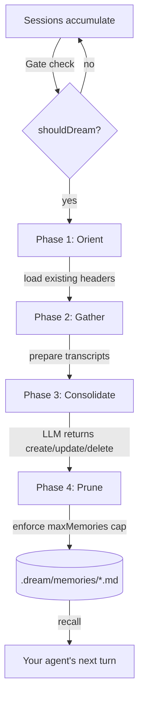

# Dream Memory

Persistent, reflective memory for AI agents. Your agent stops forgetting
between sessions because a small background process reviews the
conversation, decides what's worth keeping, and writes it down.

[](https://www.npmjs.com/package/@dream-memory/core)
[](./LICENSE)
[](https://nodejs.org)

```bash
npm install @dream-memory/core
```

---

## The short version

Most memory systems are either search (RAG) or a bigger context window.
Both miss the point. What you actually want is a process that:

1. Watches what happened.
2. Decides what was *new* and *worth remembering*.
3. Merges it with what you already know.
4. Throws out what's now wrong or obsolete.

That's what Dream Memory does. It runs a 4-phase consolidation pass
(Orient → Gather → Consolidate → Prune) over recent sessions, backed by
a two-model retrieval pattern so your recall calls stay cheap.

Zero runtime dependencies. One in-process library. MIT.

---

## 60-second example

```ts
import { Dream } from '@dream-memory/core'

const dream = new Dream({
  llm: { provider: 'openai', model: 'gpt-4o-mini' },
})

// During a session:
await dream.logSession([
  { role: 'user', content: 'We use Vitest here, not Jest.' },
  { role: 'assistant', content: 'Understood. Vitest it is.' },
])

// Later (or immediately with force=true):
await dream.dream(true)

// Next session — pull in what the agent should know:
const context = await dream.recallAsContext('how should I write tests?')
// → "## Relevant Memories\n\n### [project] Testing stack\nUse Vitest..."
```

That's it. No server, no daemon, no vector DB.

---

## Why this instead of a vector DB?

| | Vector DB | Dream Memory |
|---|---|---|
| Retrieval | Similarity search | LLM-scored relevance |
| Write strategy | Embed every chunk | Consolidate into named memories |
| Best for | Large static corpora | Ongoing relationship with one user/agent |
| Result shape | Top-K similar fragments | 1–5 curated, named facts |

They compose fine. Use a vector DB for your docs, Dream Memory for
everything the user has actually told the agent.

---

## How it works



Full breakdown with sequence diagrams lives in
[`docs/ARCHITECTURE.md`](./docs/ARCHITECTURE.md).

---

## Configuration

Defaults are tuned for a small dev agent. Override what you need.

```ts
new Dream({
  llm: {
    provider: 'openai',                     // 'openai' | 'anthropic'
    apiKey: process.env.OPENAI_API_KEY,     // or ANTHROPIC_API_KEY
    model: 'gpt-4o-mini',                   // heavy consolidation
    scoringModel: 'gpt-4o-mini',            // cheap recall scoring
    baseURL: 'http://localhost:11434/v1',   // e.g. Ollama
  },
  store: {
    type: 'filesystem',                     // or 'memory' or 'custom'
    path: '.dream',
  },
  schedule: {
    minHours: 24,
    minSessions: 5,
  },
  consolidation: {
    maxMemories: 200,
    maxRelevantMemories: 5,
  },
  debug: false,
})
```

Anthropic defaults (v0.1.2+): `claude-sonnet-4-20250514` for
consolidation, `claude-3-5-haiku-20241022` for scoring.

Works with anything that speaks the OpenAI-compatible `/chat/completions`
dialect — Ollama, LM Studio, vLLM, Together, OpenRouter, LocalAI — or
Anthropic's native `/messages` endpoint. No SDK required either way.

---

## The API surface

Eleven methods. All async.

| Method | What it does |
|---|---|
| `logSession(messages)` | Log a complete session |
| `startSession / addMessage / endSession` | Stream messages as they arrive |
| `dream(force?)` | Run the consolidation pass |
| `shouldDream()` | Cheap gate-check without running |
| `recall(query)` | Return up to 5 relevant memories |
| `recallAsContext(query)` | Same, preformatted as Markdown |
| `remember(opts)` | Explicit write, bypasses the LLM |
| `forget(id)` | Explicit delete |
| `onEvent(fn)` | Observe phase events; returns unsubscribe |
| `startAutoSchedule / stopAutoSchedule` | Background dreaming loop |

Full types in `src/types/index.ts`.

---

## Documentation

| | |
|---|---|
| [`docs/ARCHITECTURE.md`](./docs/ARCHITECTURE.md) | How the pieces fit together |
| [`docs/DATA_FLOW.md`](./docs/DATA_FLOW.md) | Step-by-step trace of every method |
| [`docs/SECURITY.md`](./docs/SECURITY.md) | Threat model + mitigations |
| [`docs/USAGE_GUIDE.md`](./docs/USAGE_GUIDE.md) | Three end-to-end scenarios |
| [`docs/FAQ.md`](./docs/FAQ.md) | Honest answers to common questions |
| [`AUDIT_REPORT.md`](./AUDIT_REPORT.md) | v0.1.2 audit findings + fixes |
| [`benchmarks/results.md`](./benchmarks/results.md) | Real numbers, not hand-waving |

---

## Status

**v0.1.2 (current)** — hardened after external audit. Fixes for three
critical bugs (endSession data loss, frontmatter parser, session-clear
race), two security findings (prompt injection, path traversal), LLM
retry, multi-handler events, refreshed default models. Full details in
[AUDIT_REPORT.md](./AUDIT_REPORT.md).

**Public API** may change between minor versions until v1.0.
`MemoryStoreAdapter` is the longest-lived contract — treat it as
near-stable already.

Node ≥ 18. ESM. Zero runtime dependencies.

---

## Contributing

Bug reports, adapter implementations, and doc fixes all welcome. See
[CONTRIBUTING.md](./CONTRIBUTING.md).

To run the test suite:

```bash
cd packages/dream-core
npm install
npm test
```

---

## License

MIT © Shubham Dusane

Built because my agents kept forgetting things and I didn't want to
rent a vector DB to fix it.
