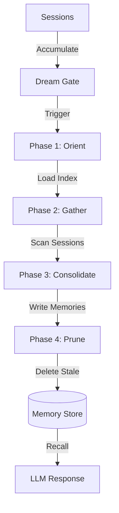

<div align="center">

# 🌙 Dream Memory

**The persistent, reflective memory layer for AI.**

*Inspired by the internal consolidation architecture of state-of-the-art LLM systems.*

[](https://www.npmjs.com/package/@dream-memory/core)
[](https://opensource.org/licenses/MIT)
[](https://www.typescriptlang.org)
[](http://makeapullrequest.com)

[**Quickstart**](#-quickstart) · [**The Architecture**](#-the-architecture) · [**How It Works**](#-how-it-works) · [**Integrations**](#-integrations) · [**Contributing**](#-contributing)

</div>

---

## 💡 The Vision

Most AI systems treat memory as either **Search** (RAG) or **Context** (Long Context). But real memory is **Reflection**. 

Humans don't remember every word they heard today; they dream. During sleep, the brain reviews the day, identifies important signals, merges them with existing knowledge, and prunes the noise.

**Dream Memory** brings this "Consolidation Cycle" to your AI stack. It’s not just a database; it’s a background process that makes your AI smarter over time.

---

## ✨ Features

- **🧠 4-Phase Consolidation** — Orient, Gather, Consolidate, and Prune (inspired by Anthropic's Claude Code).
- **🔍 Two-Model Retrieval** — A lightweight model scores relevance instantly, while a main model handles complex reasoning.
- **📁 Typed Taxonomy** — Organizes knowledge into `user`, `feedback`, `project`, and `reference` memories.
- **⏰ Smart Scheduling** — Time and session-based gates ensure dreaming only happens when there's enough new "signal."
- **💾 Local First** — Stores memories as human-readable Markdown files. Git-friendly and fully transparent.
- **📡 Event-Driven** — Hook into every phase of the dream cycle for full observability.

---

## 🚀 Quickstart

### 1. Install
```bash
npm install @dream-memory/core
```

### 2. Basic Usage
```typescript
import { Dream } from '@dream-memory/core'

const dream = new Dream({
  llm: { model: 'gpt-4o-mini', provider: 'openai' }
})

// 1. Log a conversation session
await dream.logSession([
  { role: 'user', content: 'In this project, we use Vitest instead of Jest.' },
  { role: 'assistant', content: 'Got it. I will use Vitest for tests.' }
])

// 2. Trigger the reflective 'dream' pass
// (Usually runs in background; 'true' forces it immediately)
const result = await dream.dream(true)
console.log(result.summary) 
// → "Consolidated 1 new project preference: Vitest for testing."

// 3. Recall context in the next session
const context = await dream.recallAsContext("How should I write tests?")
```

---

## 🔬 The Architecture

Dream Memory operates on a reflective loop that mirrors biological memory consolidation.



### The 4-Phase Cycle

1.  **Orient**: The system reviews the existing memory index to understand current context.
2.  **Gather**: It scans recent session transcripts to find new signals, preferences, or facts.
3.  **Consolidate**: It creates new memories or updates existing ones, resolving contradictions.
4.  **Prune**: It deletes outdated or low-value memories to keep the context window clean.

---

## 🛠 API Reference

### Configuration
```typescript
const dream = new Dream({
  llm: {
    model: 'gpt-4o-mini',        // Primary intelligence
    provider: 'openai',          // 'openai' | 'anthropic'
    scoringModel: 'gpt-4o-mini', // Faster model for retrieval scoring
  },
  store: {
    type: 'filesystem',          // Permanent storage
    path: '.dream',              // Directory for memories
  },
  schedule: {
    minHours: 24,                // Minimum time between dreams
    minSessions: 5,              // Minimum sessions before dreaming
  }
})
```

---

## 🤝 Contributing

We welcome contributions from the community! Whether it's adding a new storage adapter (Redis, Postgres) or improving the consolidation prompts, your help is appreciated.

See [CONTRIBUTING.md](./CONTRIBUTING.md) for more details.

---

## 📄 License

MIT © [Shubham Dusane](https://github.com/shubhamdusane)
