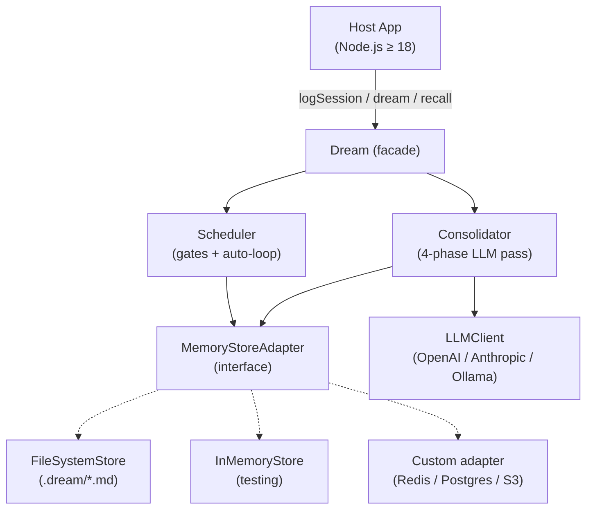
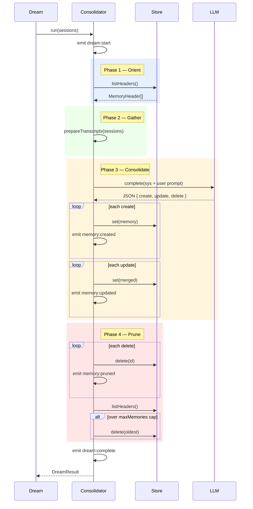

# Architecture

> Dream Memory — internal architecture & design decisions.
> Target audience: contributors, integrators, and anyone evaluating the
> library for production use.

---

## 1. System Overview

Dream Memory is a **library**, not a service. It runs in-process inside the
consumer's Node.js application. Every call happens on the caller's event
loop; there is no daemon, no server, no scheduler outside the host process.



**Design pillars:**
- **Zero runtime dependencies.** Native `fetch`, native `crypto.randomUUID`.
- **Swappable storage** via a 9-method adapter interface.
- **Event-driven observability** — every phase transition emits an event.
- **Local-first.** Memories live as Markdown files under `.dream/`.

---

## 2. Core Components

### 2.1 `Dream` (facade)

The only class consumers interact with. Wraps the three subsystems behind
a flat async API.

| Method | Purpose |
|---|---|
| `logSession(messages)` | Shorthand: push a complete session in one call |
| `startSession/addMessage/endSession` | Streaming pattern for incremental logging |
| `dream(force?)` | Run the consolidation pass |
| `shouldDream()` | Cheap gate-check without running |
| `recall(query)` | Return up to 5 relevant memories |
| `recallAsContext(query)` | Return a preformatted Markdown block |
| `remember(opts)` | Explicit memory write (bypasses the LLM) |
| `forget(id)` | Explicit delete |
| `onEvent(fn)` | Observe phase events; returns unsubscribe fn |
| `startAutoSchedule` / `stopAutoSchedule` | Background dreaming loop |

### 2.2 `Consolidator` (the 4-phase engine)



### 2.3 `Scheduler` (cost control)

Two stacked gates determine when `dream()` is allowed to burn tokens:

1. **Time gate** — `hoursSinceLastDream ≥ minHours` (default 24h).
2. **Session gate** — `sessionsSinceLastDream ≥ minSessions` (default 5).

The first run bypasses the time gate (`lastConsolidatedAt === 0 ⇒ Infinity`).
`force=true` bypasses both.

### 2.4 `MemoryStoreAdapter` (the most important interface in the library)

Nine methods. Implement this to plug in Redis, Postgres, S3, etc.

```ts
interface MemoryStoreAdapter {
  get(id): Promise<Memory | null>
  set(memory): Promise<void>
  delete(id): Promise<void>
  listHeaders(): Promise<MemoryHeader[]>
  list(filter?): Promise<Memory[]>
  getLastConsolidatedAt(): Promise<number>
  setLastConsolidatedAt(ts): Promise<void>
  logSession(id): Promise<void>
  countSessionsSince(ts): Promise<number>
  clear(): Promise<void>
}
```

Built-in implementations:
- `FileSystemStore` — default. `.dream/memories/{id}.md`.
- `InMemoryStore` — tests / ephemeral agents.

### 2.5 `LLMClient` (thin HTTP client)

Speaks two dialects:
- **OpenAI-compatible** (`/chat/completions`): OpenAI, Ollama, LM Studio,
  LocalAI, vLLM, Together, OpenRouter.
- **Anthropic native** (`/messages`): Claude.

Features:
- Exponential-backoff retry on `408/429/5xx` + network errors (3 attempts).
- Two-model split: `complete()` uses the heavy model; `score()` uses
  the cheap `scoringModel`.
- Zero SDK dependencies.

---

## 3. The Two-Model Pattern

```mermaid
graph LR
    Q[Query: 'which db?'] --> H[listHeaders]
    H -->|200 headers, ~5k tokens| Score[scoringModel<br/>gpt-4o-mini]
    Score -->|'[id1, id5]'| Load[store.get]
    Load -->|2 full memories| Ret[return]
```

For retrieval, Dream sends **only headers** (name + description + type) to
a cheap model, asks for IDs, then loads full content for the chosen few.
This is ~10× cheaper than sending every memory body to a large model and
is the same pattern used by Claude Code's internal memory system.

---

## 4. Directory Layout (FileSystemStore)

```
.dream/
├── MEMORY.md                 # human-readable auto-generated index
├── .consolidate-lock         # mtime = lastConsolidatedAt
├── .sessions.json            # { sessions: [{id, loggedAt}] } — last 1000
└── memories/
    ├── 2d1f9c…md             # one file per memory
    ├── a83b01…md
    └── …
```

Each memory file:
```markdown
---
id: 2d1f9c-…
name: "API reference: https://api.example.com/v1"
description: "Payment API v2 docs"
type: reference
createdAt: 1713657600000
updatedAt: 1713657600000
---

Use /payments endpoint. Auth: Bearer token. Rate limit: 1000/min.
```

Values containing `:` are quoted (colon-safe parser added in v0.1.2).

---

## 5. Threading & Concurrency Model

Dream Memory is **single-process** by design. Inside one Node.js process:
- Scheduler's `isRunning` flag prevents overlapping auto-dreams.
- `FileSystemStore` does NOT implement cross-process locking. If you run
  multiple processes (PM2 cluster, serverless, Kubernetes) pointing at the
  same `.dream/` directory, you will get race conditions.

For multi-process: implement a custom adapter backed by Redis/Postgres
with advisory locks, or run a single "dream worker" process.

---

## 6. Configuration Reference

See `src/types/index.ts` for complete types. Quick view:

```ts
new Dream({
  llm: {
    model: 'gpt-4o-mini',          // heavy
    scoringModel: 'gpt-4o-mini',   // cheap
    provider: 'openai' | 'anthropic',
    apiKey?: string,
    baseURL?: string,              // for Ollama etc.
    maxTokens?: 4096,
  },
  store: {
    type: 'filesystem' | 'memory' | 'custom',
    path?: '.dream',
    adapter?: MemoryStoreAdapter,  // when type === 'custom'
  },
  schedule: {
    minHours: 24,
    minSessions: 5,
    enabled: true,
  },
  consolidation: {
    maxMemories: 200,
    maxRelevantMemories: 5,
    extraPrompt?: string,
  },
  debug: false,
})
```

---

## 7. Performance Characteristics

LLM-bound operations (`dream()`, LLM-scored `recall()`) are dominated by provider latency, which this repo has not benchmarked. Earlier drafts of this section quoted figures for those operations; they were not backed by a reproducible run and have been removed.

The only measured numbers are the non-LLM filesystem micro-benchmarks in [`benchmarks/results.md`](../benchmarks/results.md), with the machine they were run on. They vary a lot by OS, filesystem and antivirus; run `npm run bench` on your own hardware.

---

## 8. Security Model

See [`SECURITY.md`](./SECURITY.md). Summary:
- Session transcripts are treated as **untrusted** in Phase 3 prompts.
- Memory IDs passed to `FileSystemStore` are validated against
  `/^[A-Za-z0-9][A-Za-z0-9_-]{0,127}$/` to prevent path traversal.
- API keys come from config or env vars, never from disk or LLM output.

---

## 9. Stability & Versioning

- **v0.x** — API may change between minor versions; read the changelog.
- **v1.0** — public API will be frozen. `MemoryStoreAdapter` is the
  longest-lived contract; treat it as near-stable already.
- Node.js ≥ 18 is a hard floor (`fetch`, `randomUUID`, ESM).

---

## 10. Further Reading

- [`DATA_FLOW.md`](./DATA_FLOW.md) — step-by-step request traces
- [`SECURITY.md`](./SECURITY.md) — threat model + mitigations
- [`USAGE_GUIDE.md`](./USAGE_GUIDE.md) — 3 concrete scenarios, end to end
- [`FAQ.md`](./FAQ.md) — answers to common critiques
- [`../AUDIT_REPORT.md`](../AUDIT_REPORT.md) — v0.1.2 code-review findings
- [`../benchmarks/results.md`](../benchmarks/results.md) — real numbers
