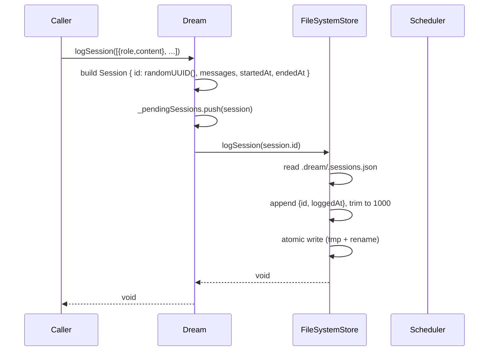
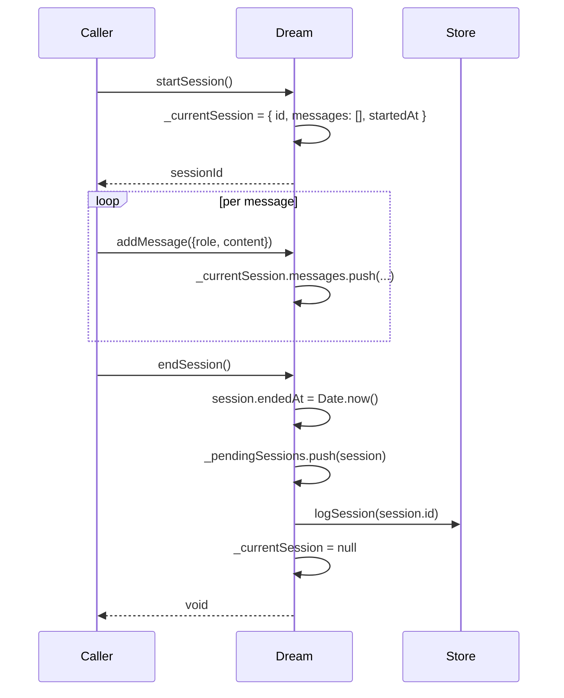
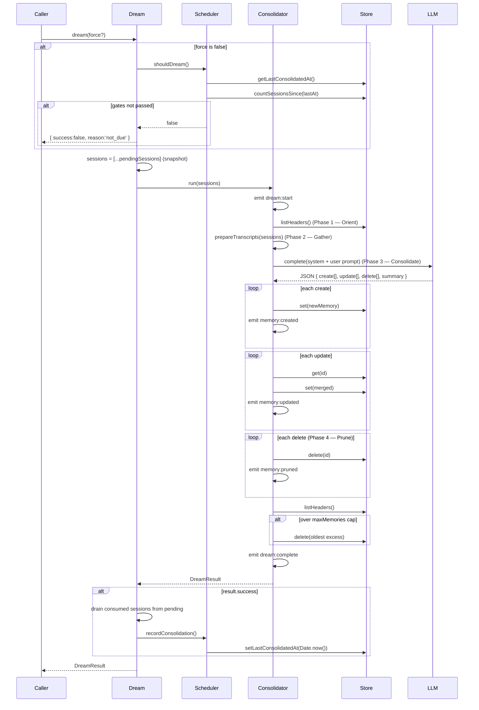
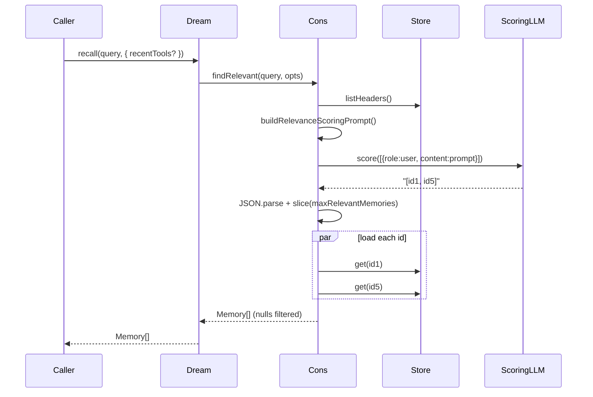
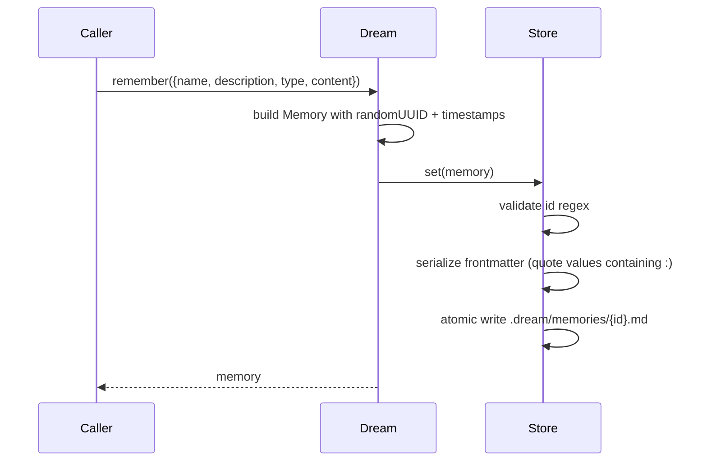
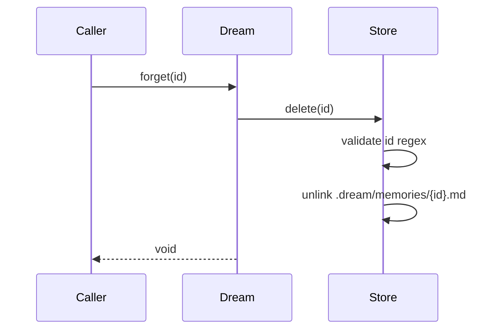
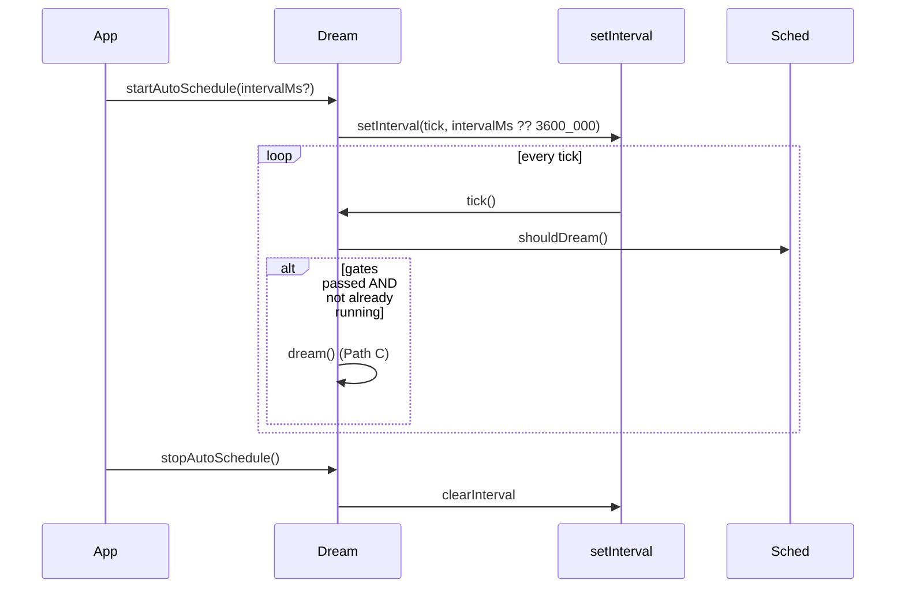

# Data Flow

> Step-by-step traces of every Dream Memory request path.
> Read this after [`ARCHITECTURE.md`](./ARCHITECTURE.md) — that doc tells you
> *what* the pieces are, this doc tells you *what happens when you call them*.

---

## 1. Path catalogue

| # | Entry point | When it runs | Network calls |
|---|---|---|---|
| A | `logSession(messages)` | After each user interaction | 0 |
| B | `startSession` / `addMessage` / `endSession` | Streaming equivalent of A | 0 |
| C | `dream()` / `dream(true)` | Periodic consolidation | 1 (main model) |
| D | `recall(query)` / `recallAsContext(query)` | Before each LLM turn | 1 (scoring model) + N disk reads |
| E | `remember({...})` | Explicit write, no LLM | 0 |
| F | `forget(id)` | Explicit delete | 0 |
| G | `startAutoSchedule()` loop | Background timer | 0 or 1 per tick |

All paths share one guarantee: **no hidden state, no daemon.** Every side
effect happens inside the caller's event loop.

---

## 2. Path A — `logSession(messages)`

### Sequence



### Files touched

- `.dream/.sessions.json` — appended, atomically replaced.
- In-memory `_pendingSessions` array — grows until next `dream()`.

### Failure modes

| Failure | Observable effect |
|---|---|
| Disk full | `logSession` throws. Session NOT counted. |
| `.sessions.json` corrupt | Silently reset to `{ sessions: [session] }`. |
| Process crash between push and write | Session lost from disk count but still in `_pendingSessions` until process restart. |

---

## 3. Path B — `startSession` / `addMessage` / `endSession`

Same invariant as Path A but split across three calls so you can log
messages as they stream in.



### Historical bug (fixed v0.1.2)

Pre-v0.1.2: `endSession()` called `store.logSession(id)` but **never
pushed the session into `_pendingSessions`.** Result: sessions were
counted toward the session-gate but their messages were invisible to
the consolidator. Memories never reflected streaming sessions.

Fix: explicit `this._pendingSessions.push(session)` in `endSession`.
Regression test in `tests/dream.test.ts` → "endSession queues messages
for consolidation".

---

## 4. Path C — `dream()` / `dream(true)`

The expensive path. One call ≈ one LLM round-trip + N memory writes.

### Sequence



### Session-clear race (fixed v0.1.2)

Pre-v0.1.2:

```ts
// BROKEN
await this.consolidator.run(this._pendingSessions)
this._pendingSessions = []   // nukes sessions logged during the LLM call
```

Any `logSession()` call that landed between `run(...)` and the
assignment was silently dropped.

Fixed by:
1. Snapshot `const sessions = [...this._pendingSessions]` upfront.
2. Run the consolidator inside try/catch; throw on failure, skip the
   drain so nothing is lost.
3. On success: drain only the snapshotted IDs via a `Set<consumedIds>`
   filter, preserving anything that arrived mid-consolidation.

### Failure modes

| Failure | State after |
|---|---|
| LLM 5xx | Retry (3×, exponential backoff). If still failing, `run()` returns `success:false`, pending sessions preserved. |
| LLM returns bad JSON | `parseConsolidationResponse` catches, returns empty actions. No memories changed. Pending sessions preserved. |
| `store.set` throws mid-loop | Propagates. Memories created before the throw persist; drain skipped. |
| Caller aborts | No abort signal plumbing. LLM call completes in background. |

---

## 5. Path D — `recall(query)`

Cheap. One small LLM call + up to 5 disk reads.

### Sequence



### Why two models?

See [ARCHITECTURE §3](./ARCHITECTURE.md#3-the-two-model-pattern).
Scoring model sees only headers (name + description + type, ~30 tokens
each). Large model never touches retrieval.

### `recallAsContext(query)`

Thin wrapper around `recall()`. Formats the results as Markdown:

```
## Relevant Memories

### [user] Name
Description.

Content...
```

Drop it directly into your system prompt.

### Failure modes

| Failure | Return value |
|---|---|
| Empty store | `[]` |
| Scoring LLM errors | `[]` (logged in debug) |
| Scoring LLM returns malformed JSON | `[]` (logged in debug) |
| One of the IDs was deleted mid-request | That slot filtered out; others returned |

---

## 6. Path E — `remember({...})`

No LLM. Useful when you already *know* a fact and don't want to pay
for consolidation to surface it.



### Frontmatter hazard (fixed v0.1.2)

Writing a memory with `name: "API reference: https://..."` used to
produce unparseable YAML because every `:` split the key from the
value. Parser now:
- Splits on FIRST colon only.
- Strips matching quotes.
- Serializer quotes any value containing `:`, `"`, `'`, `#`, or a
  leading `-`.

Regression test: "FileSystemStore handles colons in frontmatter values".

---

## 7. Path F — `forget(id)`

No LLM. Hard delete.



ID validation regex `/^[A-Za-z0-9][A-Za-z0-9_-]{0,127}$/` blocks path
traversal. `forget('../../etc/passwd')` throws `Invalid memory id`.

Regression test: "rejects invalid memory ids (path traversal)".

---

## 8. Path G — Auto-schedule loop



Guard: `isRunning` flag prevents overlapping dreams inside one process.
Multi-process? See [ARCHITECTURE §5](./ARCHITECTURE.md#5-threading--concurrency-model).

---

## 9. Event stream (cross-cutting)

Every phase transition in Path C emits an event. Subscribe with
`dream.onEvent(handler)` — returns an unsubscribe function.

| Event | Fired during | Payload |
|---|---|---|
| `dream:start` | Path C, before Phase 1 | `{ sessionCount }` |
| `dream:phase` | Entry to each phase | `{ phase: 'orient' \| 'gather' \| 'consolidate' \| 'prune' }` |
| `dream:memory:created` | Per Phase 3 create | `{ memory }` |
| `dream:memory:updated` | Per Phase 3 update | `{ memory }` |
| `dream:memory:pruned` | Per Phase 4 delete | `{ id, reason }` |
| `dream:complete` | Path C success | `{ result }` |
| `dream:error` | Path C failure | `{ error }` |

Multi-handler support (fixed v0.1.2): handlers stored in an array,
`emit()` iterates with per-handler try/catch so one throwing observer
can't break consolidation.

---

## 10. Timing budget (typical)

For a 50-memory store, 10 recent sessions, `gpt-4o-mini`:

| Operation | Disk I/O | LLM | Total wall |
|---|---|---|---|
| `logSession` | 1 read + 1 write (~sessions.json) | — | 5–15 ms |
| `dream()` | 1 listHeaders + ~10 writes | 1 × 3–6s | 3–6 s |
| `recall()` | 1 listHeaders + 5 gets | 1 × 0.5–0.9s | 500–900 ms |
| `remember()` | 1 write | — | 20–40 ms |
| `forget()` | 1 unlink | — | 5–15 ms |

LLM latency dominates. Disk is negligible on SSD.

---

## 11. Further reading

- [`ARCHITECTURE.md`](./ARCHITECTURE.md) — the big picture
- [`SECURITY.md`](./SECURITY.md) — what's trusted vs. untrusted on every path
- [`USAGE_GUIDE.md`](./USAGE_GUIDE.md) — putting these paths together in real code
